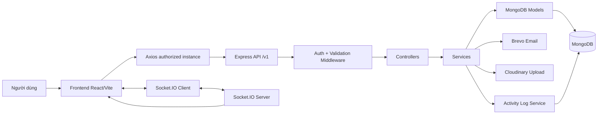
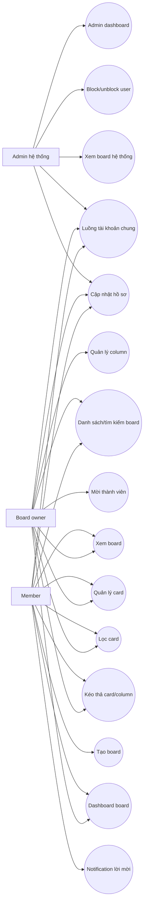
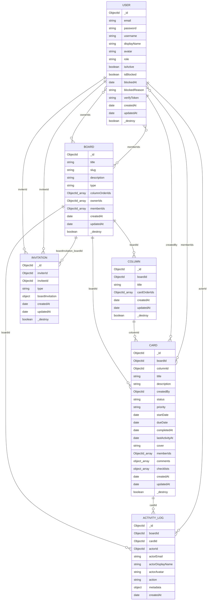
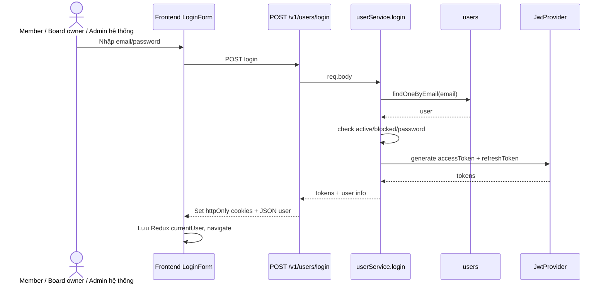
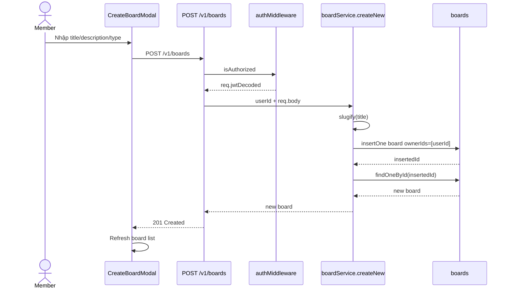
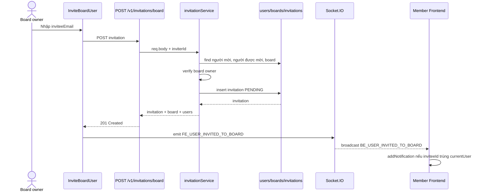
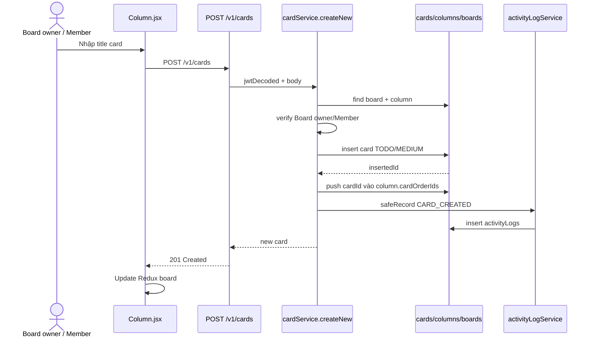
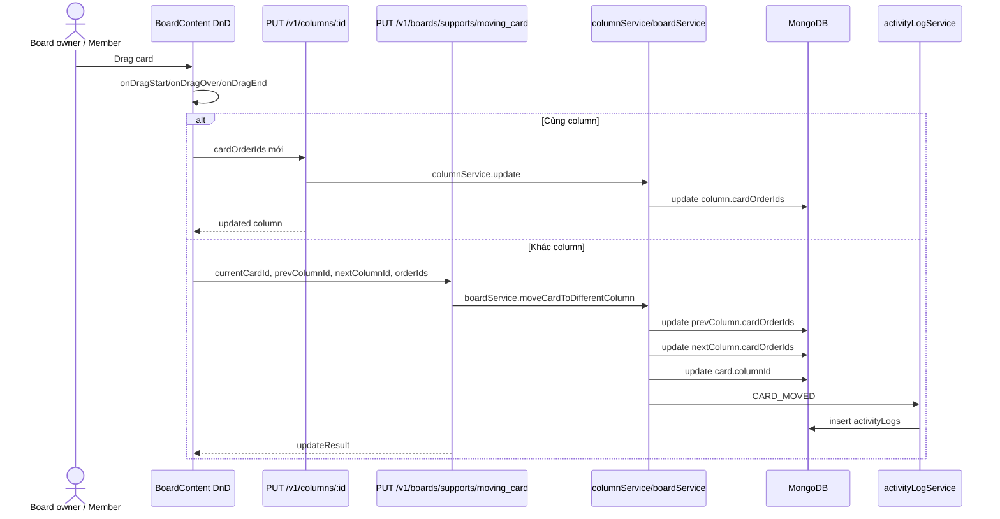
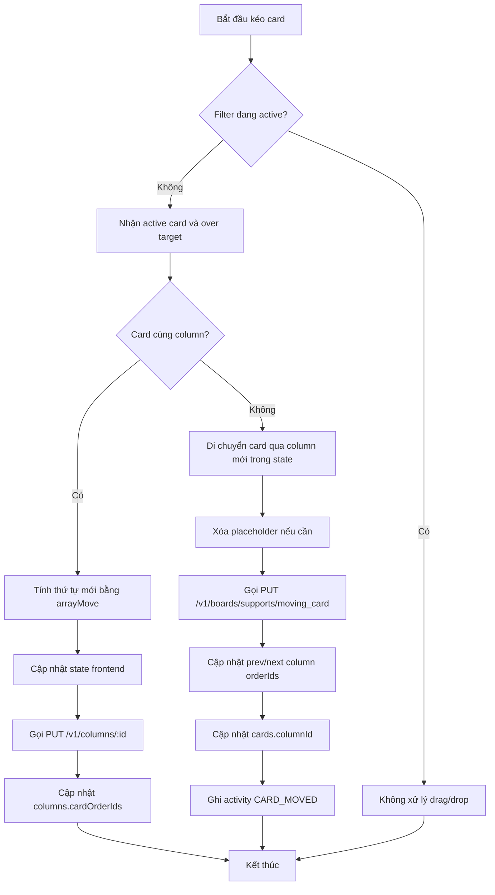
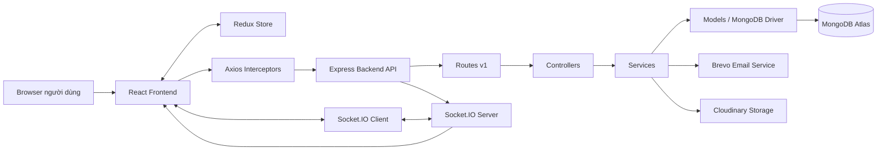

# BÁO CÁO PHÂN TÍCH PROJECT TASKFLOW

## 1. Tổng quan đề tài

- Tên đề tài: “Xây dựng hệ thống quản lý công việc theo mô hình Kanban tích hợp AI hỗ trợ quản lý và phân tích công việc”.
- Mục tiêu hệ thống: xây dựng ứng dụng quản lý công việc dạng Kanban, cho phép người dùng đăng ký, đăng nhập, tạo board, quản lý column/card, kéo thả công việc, mời thành viên, bình luận, theo dõi checklist, dashboard và quản trị hệ thống.
- Bài toán giải quyết: hỗ trợ tổ chức công việc theo board/list/card, theo dõi trạng thái, độ ưu tiên, ngày bắt đầu/hạn xử lý, thành viên phụ trách, checklist, comment và lịch sử hoạt động.
- Đối tượng sử dụng:
  - Admin hệ thống: quản trị tài khoản, block/unblock tài khoản, xem dashboard hệ thống và danh sách board toàn hệ thống.
  - Board owner: người sở hữu board, có quyền tạo/cập nhật board, tạo/xóa/cập nhật column, mời thành viên và thao tác card trong board.
  - Member: thành viên tham gia board, có quyền xem board, tạo/cập nhật card, kéo thả card, comment, checklist, filter và nhận/phản hồi lời mời.
- Quy ước actor trong báo cáo: chỉ dùng 3 actor chính `Admin hệ thống`, `Board owner`, `Member`. Các hành động đăng ký, xác thực email, đăng nhập, refresh token và cập nhật hồ sơ được xem là luồng tài khoản chung của các actor này, không tách thêm actor phụ cho trạng thái chưa đăng nhập hoặc tài khoản chung.
- Phạm vi chức năng hiện tại: xác thực tài khoản, board Kanban, column/list, card/task, lọc card trong board, drag and drop, invitation/notification realtime cho lời mời board, upload avatar/cover, dashboard board, admin console, activity log.
- Ghi chú về mức độ hoàn thiện:
  - Có nhiều chức năng chính đã có bằng chứng rõ trong frontend và backend.
  - Chưa chạy thử runtime trong quá trình phân tích, vì vậy các chức năng có code được ghi trạng thái “Cần kiểm chứng”.
  - Chưa tìm thấy module AI trong source code hiện tại. Phần AI không được xem là chức năng chính thức của project ở thời điểm phân tích.

## 2. Công nghệ sử dụng

| Thành phần | Công nghệ/Thư viện | Vai trò | Bằng chứng trong project |
|---|---|---|---|
| Frontend | React 18, Vite | Xây dựng SPA frontend | `final-full-stack-mern-advanced-web/package.json`, `src/main.jsx`, `vite.config.js` |
| UI library | MUI Material, MUI Icons, MUI Lab | Giao diện, component, icon, theme | `final-full-stack-mern-advanced-web/package.json`, `src/main.jsx`, `src/theme.js` |
| Routing frontend | react-router-dom | Route public/private/admin | `final-full-stack-mern-advanced-web/src/App.jsx` |
| State management | Redux Toolkit, React Redux, Redux Persist | Lưu user, active board, active card, notifications | `src/redux/store.js`, `src/redux/user/userSlice.js`, `src/redux/activeBoard/activeBoardSlice.js`, `src/redux/activeCard/activeCardSlice.js`, `src/redux/notifications/notificationsSlice.js` |
| API client | axios | Gọi API và interceptor refresh token | `src/apis/index.js`, `src/utils/authorizeAxios.js` |
| Form validation frontend | react-hook-form, rule tự định nghĩa | Validate form đăng ký, đăng nhập, tạo board, invite, settings | `src/pages/Auth/RegisterForm.jsx`, `src/pages/Auth/LoginForm.jsx`, `src/pages/Boards/create.jsx`, `src/utils/validators.js` |
| Backend | Node.js, Express | REST API server | `final-full-stack-mern-advanced-api/package.json`, `src/server.js`, `src/routes/v1/index.js` |
| Database | MongoDB Node.js driver | Lưu users, boards, columns, cards, invitations, activityLogs | `src/config/mongodb.js`, `src/models/*Model.js` |
| Authentication | JWT, bcryptjs, httpOnly cookies | Đăng nhập, access token, refresh token, hash password | `src/services/userService.js`, `src/controllers/userController.js`, `src/providers/JwtProvider.js`, `src/middlewares/authMiddleware.js` |
| Authorization | Role `system_admin`, Board owner/Member | Bảo vệ admin route và quyền board | `src/middlewares/authMiddleware.js`, `src/utils/boardPermissions.js`, `src/services/boardService.js`, `src/services/columnService.js`, `src/services/cardService.js`, `src/services/invitationService.js` |
| Email service | Brevo | Gửi email xác thực tài khoản | `src/providers/BrevoProvider.js`, `src/services/userService.js`, `src/config/environment.js` |
| Realtime/socket | socket.io, socket.io-client | Realtime notification khi mời Member vào board | `src/server.js`, `src/sockets/inviteUserToBoardSocket.js`, `final-full-stack-mern-advanced-web/src/socketClient.js`, `src/components/AppBar/Notifications/Notifications.jsx`, `src/pages/Boards/BoardBar/InviteBoardUser.jsx` |
| Notification | Invitation collection + Redux notifications | Hiển thị lời mời board và accept/reject | `src/models/invitationModel.js`, `src/redux/notifications/notificationsSlice.js`, `src/components/AppBar/Notifications/Notifications.jsx` |
| Upload/storage | Multer, Cloudinary | Upload avatar và card cover | `src/middlewares/multerUploadMiddleware.js`, `src/providers/CloudinaryProvider.js`, `src/services/userService.js`, `src/services/cardService.js` |
| AI module | Chưa tìm thấy bằng chứng | Không có route/service/dependency AI chính thức | Không thấy trong `package.json`, `src/routes/v1/index.js`, không có controller/service/model AI |
| Validation backend | Joi | Validate request và schema trước khi lưu MongoDB | `src/validations/*.js`, `src/models/*Model.js` |
| Drag and drop | @dnd-kit/core, @dnd-kit/sortable | Kéo thả column/card | `final-full-stack-mern-advanced-web/package.json`, `src/pages/Boards/BoardContent/BoardContent.jsx`, `src/customLibraries/DndKitSensors.js` |
| Markdown editor | @uiw/react-md-editor, rehype-sanitize | Chỉnh sửa description card dạng Markdown | `src/components/Modal/ActiveCard/CardDescriptionMdEditor.jsx` |
| Chart/dashboard | Recharts | Biểu đồ dashboard board và admin | `package.json`, `src/pages/Boards/BoardDashboard/BoardDashboard.jsx`, `src/pages/Admin/AdminDashboard.jsx` |
| Toast/confirm | react-toastify, material-ui-confirm | Thông báo và confirm dialog | `src/main.jsx`, `src/apis/index.js`, `src/pages/Boards/BoardContent/ListColumns/Column/Column.jsx` |
| Date/time | moment, Date API | Format notification/comment/activity time | `src/components/AppBar/Notifications/Notifications.jsx`, `src/components/Modal/ActiveCard/CardActivitySection.jsx` |

## 3. Cấu trúc thư mục project

- `final-full-stack-mern-advanced-web/`: frontend React/Vite.
- `final-full-stack-mern-advanced-web/src/main.jsx`: khởi tạo React app, Redux Provider, PersistGate, BrowserRouter, MUI theme, ToastContainer.
- `final-full-stack-mern-advanced-web/src/App.jsx`: khai báo route, protected route, admin route.
- `final-full-stack-mern-advanced-web/src/apis/index.js`: tập trung hàm gọi REST API.
- `final-full-stack-mern-advanced-web/src/utils/authorizeAxios.js`: axios instance, withCredentials, interceptor refresh token, auto logout.
- `final-full-stack-mern-advanced-web/src/redux/`: store và slices cho user, active board, active card, notifications.
- `final-full-stack-mern-advanced-web/src/pages/Auth/`: đăng nhập, đăng ký, xác thực email.
- `final-full-stack-mern-advanced-web/src/pages/Boards/`: danh sách board, tạo board, chi tiết board.
- `final-full-stack-mern-advanced-web/src/pages/Boards/BoardContent/`: Kanban board, DnD column/card.
- `final-full-stack-mern-advanced-web/src/pages/Boards/BoardBar/`: thanh board, invite member, user group, filter panel.
- `final-full-stack-mern-advanced-web/src/pages/Boards/BoardDashboard/`: dashboard thống kê board.
- `final-full-stack-mern-advanced-web/src/components/Modal/ActiveCard/`: modal chi tiết card, description, checklist, comment, activity log, member card.
- `final-full-stack-mern-advanced-web/src/components/AppBar/`: app bar, notification, search board, profile menu.
- `final-full-stack-mern-advanced-web/src/pages/Admin/`: admin layout, dashboard, users, boards.
- `final-full-stack-mern-advanced-web/src/customLibraries/DndKitSensors.js`: custom sensor để chặn DnD trên input/control có `data-no-dnd`.
- `final-full-stack-mern-advanced-api/`: backend Express/MongoDB.
- `final-full-stack-mern-advanced-api/src/server.js`: khởi tạo Express, CORS, cookie-parser, JSON body, routes v1, error middleware, Socket.IO.
- `final-full-stack-mern-advanced-api/src/config/`: cấu hình env, MongoDB, CORS.
- `final-full-stack-mern-advanced-api/src/routes/v1/`: route users, boards, columns, cards, invitations, admin.
- `final-full-stack-mern-advanced-api/src/controllers/`: nhận request và trả response.
- `final-full-stack-mern-advanced-api/src/services/`: xử lý nghiệp vụ.
- `final-full-stack-mern-advanced-api/src/models/`: MongoDB collection schema bằng Joi và hàm truy vấn.
- `final-full-stack-mern-advanced-api/src/middlewares/`: auth, upload, error handling.
- `final-full-stack-mern-advanced-api/src/providers/`: JWT, Brevo email, Cloudinary upload.
- `final-full-stack-mern-advanced-api/src/sockets/`: xử lý socket invitation.
- `final-full-stack-mern-advanced-api/src/utils/`: constants, validators, formatter, permission, helper.

## 4. Kiến trúc tổng thể hệ thống

Người dùng thao tác trên frontend React. Frontend gọi REST API backend thông qua axios instance có `withCredentials`, gửi/nhận cookie JWT httpOnly. Backend Express nhận request qua route, middleware auth/validation, controller và service. Service gọi model để thao tác MongoDB. Một số nghiệp vụ tích hợp Brevo để gửi email xác thực, Cloudinary để upload avatar/card cover và Socket.IO để phát realtime invitation. Dashboard được tổng hợp bằng MongoDB aggregation trong model.

## 5. Danh sách chức năng đã phát hiện

Tổng số chức năng chính có bằng chứng trong bảng: 33 chức năng.

| Mã chức năng | Nhóm chức năng | Tên chức năng | Actor | Mô tả | Frontend liên quan | Backend/API liên quan | Database liên quan | Trạng thái | Bằng chứng |
|---|---|---|---|---|---|---|---|---|---|
| F01 | Tài khoản người dùng | Đăng ký | Member / Board owner / Admin hệ thống | Tạo user mới bằng email/password, hash password, tạo verify token, gửi email xác thực | `src/pages/Auth/RegisterForm.jsx`, `src/apis/index.js` | `POST /v1/users/register`, `userRoute.js`, `userController.js`, `userService.js` | `users` | Có code - Cần kiểm chứng | `userService.createNew`, `userModel.createNew`, `BrevoProvider.sendEmail` |
| F02 | Tài khoản người dùng | Xác thực email | Member / Board owner / Admin hệ thống | Verify tài khoản bằng email và token trên URL | `src/pages/Auth/AccountVerification.jsx` | `PUT /v1/users/verify`, `userService.verifyAccount` | `users.isActive`, `users.verifyToken` | Có code - Cần kiểm chứng | `userRoute.js`, `userService.js`, `userModel.verifyAccount` |
| F03 | Tài khoản người dùng | Đăng nhập | Member / Board owner / Admin hệ thống | Kiểm tra email/password, active/blocked, tạo accessToken/refreshToken, set cookie | `src/pages/Auth/LoginForm.jsx`, `src/redux/user/userSlice.js` | `POST /v1/users/login`, `userController.login`, `userService.login` | `users` | Có code - Cần kiểm chứng | `JwtProvider.js`, `authMiddleware.js` |
| F04 | Tài khoản người dùng | Refresh token và logout | Member / Board owner / Admin hệ thống | Refresh accessToken từ refreshToken cookie, logout xóa cookie và clear Redux user | `src/utils/authorizeAxios.js`, `src/redux/user/userSlice.js`, `Profiles.jsx` | `GET /v1/users/refresh_token`, `DELETE /v1/users/logout` | Không đổi DB | Có code - Cần kiểm chứng | `userController.refreshToken`, `authorizeAxios.js` |
| F05 | Hồ sơ cá nhân | Cập nhật displayName/avatar/password | Member / Board owner / Admin hệ thống | Cập nhật tên hiển thị, upload avatar, đổi mật khẩu | `src/pages/Settings/AccountTab.jsx`, `src/pages/Settings/SecurityTab.jsx` | `PUT /v1/users/update` | `users.displayName`, `users.avatar`, `users.password` | Có code - Cần kiểm chứng | `userRoute.js`, `userService.update`, `CloudinaryProvider.js` |
| F06 | Board | Danh sách, tìm kiếm, phân trang board | Board owner / Member | Lấy board thuộc Board owner/Member, tìm theo title, phân trang | `src/pages/Boards/index.jsx`, `AutoCompleteSearchBoard.jsx` | `GET /v1/boards` | `boards` | Có code - Cần kiểm chứng | `boardModel.getBoards`, `fetchBoardsAPI` |
| F07 | Board | Tạo board | Member | Tạo board public/private; người tạo trở thành Board owner của board mới | `src/pages/Boards/create.jsx` | `POST /v1/boards` | `boards.ownerIds`, `boards.columnOrderIds` | Có code - Cần kiểm chứng | `boardService.createNew`, `boardModel.createNew` |
| F08 | Board | Xem chi tiết board | Board owner / Member | Lấy board kèm columns, cards, owners, members | `src/pages/Boards/_id.jsx`, `activeBoardSlice.js` | `GET /v1/boards/:id` | `boards`, `columns`, `cards`, `users` | Có code - Cần kiểm chứng | `boardModel.getDetails`, `boardService.getDetails` |
| F09 | Board | Cập nhật board/reorder column | Board owner | API cập nhật title/description/type/columnOrderIds; frontend dùng cho kéo thả column | `src/pages/Boards/_id.jsx` | `PUT /v1/boards/:id` | `boards.columnOrderIds`, `boards.updatedAt` | Có code - Cần kiểm chứng | `boardValidation.update`, `boardService.update` |
| F10 | Dashboard/thống kê | Board dashboard | Board owner / Member | Tổng hợp card theo status, priority, overdue, due soon, checklist, workload | `src/pages/Boards/BoardDashboard/BoardDashboard.jsx` | `GET /v1/boards/:id/dashboard` | `cards`, `users` | Có code - Cần kiểm chứng | `cardModel.getBoardDashboard`, `boardService.getDashboard` |
| F11 | Column/List | Tạo column | Board owner | Tạo list trong board và push vào `columnOrderIds` | `ListColumns.jsx` | `POST /v1/columns` | `columns`, `boards.columnOrderIds` | Có code - Cần kiểm chứng | `columnService.createNew`, `boardModel.pushColumnOrderIds` |
| F12 | Column/List | Cập nhật column | Board owner / Member | Đổi title column hoặc cập nhật thứ tự card trong column; Member chỉ có quyền update `cardOrderIds` | `Column.jsx`, `Board.jsx` | `PUT /v1/columns/:id` | `columns.title`, `columns.cardOrderIds` | Có code - Cần kiểm chứng | `columnService.update`, `columnModel.update` |
| F13 | Column/List | Xóa column kèm cards | Board owner | Xóa column, xóa toàn bộ card thuộc column, pull columnId khỏi board | `Column.jsx` | `DELETE /v1/columns/:id` | `columns`, `cards`, `boards.columnOrderIds` | Có code - Cần kiểm chứng | `columnService.deleteItem`, `cardModel.deleteManyByColumnId` |
| F14 | Kéo thả | Kéo thả column | Board owner | Dùng DnD Kit để đổi thứ tự column, cập nhật `board.columnOrderIds` | `BoardContent.jsx`, `ListColumns.jsx`, `Board.jsx` | `PUT /v1/boards/:id` | `boards.columnOrderIds` | Có code - Cần kiểm chứng | `moveColumns` trong `Boards/_id.jsx` |
| F15 | Card/Task | Tạo card/task | Board owner / Member | Tạo card trong column, set status/priority mặc định, push vào `cardOrderIds`, ghi activity | `Column.jsx` | `POST /v1/cards` | `cards`, `columns.cardOrderIds`, `activityLogs` | Có code - Cần kiểm chứng | `cardService.createNew`, `activityLogService.safeRecordCardActivity` |
| F16 | Card/Task | Cập nhật title/description card | Board owner / Member | Sửa title bằng input focus, sửa description Markdown | `ActiveCard.jsx`, `CardDescriptionMdEditor.jsx` | `PUT /v1/cards/:id` | `cards.title`, `cards.description` | Có code - Cần kiểm chứng | `cardService.update`, `cardModel.update` |
| F17 | Card/Task | Status, priority, start date, due date, complete | Board owner / Member | Cập nhật trạng thái, độ ưu tiên, ngày bắt đầu/hạn, completedAt | `ActiveCard.jsx`, `Card.jsx`, `BoardFilterPanel.jsx` | `PUT /v1/cards/:id` | `cards.status`, `cards.priority`, `cards.startDate`, `cards.dueDate`, `cards.completedAt` | Có code - Cần kiểm chứng | `cardValidation.update`, `cardService.validateMergedDateRange`, `applyStatusSideEffects` |
| F18 | Upload/storage | Upload card cover | Board owner / Member | Upload ảnh cover card qua FormData lên Cloudinary | `ActiveCard.jsx` | `PUT /v1/cards/:id` with `cardCover` | `cards.cover` | Có code - Cần kiểm chứng | `multerUploadMiddleware.js`, `CloudinaryProvider.js`, `cardService.update` |
| F19 | Thành viên card | Gán/xóa member card, join/leave card | Board owner / Member | Chọn tài khoản thuộc board để add/remove vào `card.memberIds`, tài khoản hiện tại có thể join/leave | `ActiveCard.jsx`, `CardUserGroup.jsx` | `PUT /v1/cards/:id` | `cards.memberIds`, `activityLogs` | Có code - Cần kiểm chứng | `cardModel.updateMembers`, `CARD_MEMBER_ACTIONS` |
| F20 | Checklist/subtask | Checklist và checklist item | Board owner / Member | Tạo/đổi tên/xóa checklist, thêm/đổi tên/toggle/xóa item | `CardChecklistSection.jsx`, `ActiveCard.jsx` | `PUT /v1/cards/:id` | `cards.checklists` embedded | Có code - Cần kiểm chứng | `cardService.handleChecklistAction`, `cardModel.addChecklist*` |
| F21 | Comment | Comment trong card | Board owner / Member | Thêm comment vào đầu mảng comments, hiển thị phân trang comment | `CardActivitySection.jsx`, `ActiveCard.jsx` | `PUT /v1/cards/:id` | `cards.comments`, `activityLogs` | Có code - Cần kiểm chứng | `cardModel.unshiftNewComment`, `CARD_ACTIVITY_ACTIONS.COMMENT_CREATED` |
| F22 | Activity log | System log card | Board owner / Member | Ghi và lấy lịch sử card created/moved/status/priority/dates/checklist/member/cover/comment | `CardActivitySection.jsx` | `GET /v1/cards/:id/activities` | `activityLogs` | Có code - Cần kiểm chứng | `activityLogModel.js`, `activityLogService.js` |
| F23 | Kéo thả | Kéo thả card trong cùng column | Board owner / Member | Reorder card trong một column, cập nhật `column.cardOrderIds` | `BoardContent.jsx`, `Boards/_id.jsx` | `PUT /v1/columns/:id` | `columns.cardOrderIds` | Có code - Cần kiểm chứng | `moveCardInTheSameColumn`, `columnService.update` |
| F24 | Kéo thả | Kéo thả card sang column khác | Board owner / Member | Cập nhật cardOrderIds của 2 column và `card.columnId`, ghi activity moved | `BoardContent.jsx`, `Boards/_id.jsx` | `PUT /v1/boards/supports/moving_card` | `columns.cardOrderIds`, `cards.columnId`, `activityLogs` | Có code - Cần kiểm chứng | `boardService.moveCardToDifferentColumn` |
| F25 | Thành viên board | Mời thành viên vào board | Board owner | Tạo invitation cho Member được mời theo email | `InviteBoardUser.jsx` | `POST /v1/invitations/board` | `invitations` | Có code - Cần kiểm chứng | `invitationService.createNewBoardInvitation`, `invitationModel.createNewBoardInvitation` |
| F26 | Notification | Xem và phản hồi invitation | Member | Lấy danh sách lời mời, accept/reject; accept thì thêm vào `board.memberIds` | `Notifications.jsx`, `notificationsSlice.js` | `GET /v1/invitations`, `PUT /v1/invitations/board/:invitationId` | `invitations`, `boards.memberIds` | Có code - Cần kiểm chứng | `invitationService.updateBoardInvitation`, `boardModel.pushMemberIds` |
| F27 | Realtime | Realtime invitation notification | Board owner / Member | Board owner gửi lời mời, server broadcast, Member nhận notification realtime | `InviteBoardUser.jsx`, `Notifications.jsx`, `socketClient.js` | Socket events `FE_USER_INVITED_TO_BOARD`, `BE_USER_INVITED_TO_BOARD` | Không đổi DB trực tiếp qua socket | Có code - Cần kiểm chứng | `sockets/inviteUserToBoardSocket.js`, `server.js` |
| F28 | Phân quyền | Quyền Board owner/Member | Board owner / Member | Board owner quản lý board/column; Board owner/Member có thể thao tác card; API kiểm tra membership | Nhiều component ẩn/hiện action theo owner | `boardPermissions.js`, services board/column/card/invitation | `boards.ownerIds`, `boards.memberIds` | Có code - Cần kiểm chứng | `verifyBoardOwner`, `verifyBoardOwnerOrMember` trong services |
| F29 | Admin | Admin dashboard | Admin hệ thống | Xem tổng tài khoản active/blocked, boards, cards | `AdminDashboard.jsx` | `GET /v1/admin/dashboard` | `users`, `boards`, `cards` | Có code - Cần kiểm chứng | `adminRoute.js`, `adminService.getDashboard` |
| F30 | Admin | Quản lý tài khoản/block tài khoản | Admin hệ thống | Danh sách tài khoản, tìm kiếm, phân trang, block/unblock tài khoản | `AdminUsers.jsx`, `BlockUserDialog.jsx` | `GET /v1/admin/users`, `PUT /v1/admin/users/:id/status` | `users.isBlocked`, `users.blockedAt`, `users.blockedReason` | Có code - Cần kiểm chứng | `adminService.updateUserStatus`, `userModel.adminUpdateStatus` |
| F31 | Admin | Xem board toàn hệ thống | Admin hệ thống | Danh sách board, tìm title, xem info board | `AdminBoards.jsx` | `GET /v1/admin/boards` | `boards` | Có code - Cần kiểm chứng | `boardModel.getAllBoards`, `adminService.getBoards` |
| F32 | Admin/phân quyền hệ thống | Cập nhật role user | Admin hệ thống | Backend có API đổi role user/system_admin, có guard không tự đổi role và không demote admin cuối | Chưa thấy UI gọi API này | `PUT /v1/admin/users/:id/role` | `users.role` | Có backend - Cần kiểm chứng, thiếu bằng chứng UI | `adminRoute.js`, `adminService.updateUserRole`, `userModel.adminUpdateRole` |
| F33 | Board/Card | Lọc card trong board | Board owner / Member | Lọc card trên board theo title, status, priority, overdue, due soon, assigned to me; khi filter active thì drag-and-drop bị disable | `BoardFilterPanel.jsx`, `Boards/_id.jsx`, `BoardBar.jsx`, `BoardDashboard.jsx` | Không có API filter card riêng; xử lý phía frontend trên dữ liệu board đã tải | Không đổi DB | Có code - Cần kiểm chứng | `doesCardMatchFilters`, `getFilterActiveCount`, `BoardFilterPanel`, `handleDashboardDrillDown` |

### Chức năng chưa tìm thấy bằng chứng

- AI hỗ trợ quản lý/phân tích công việc: chưa thấy dependency, route, service, controller, model hoặc UI AI.
- Quên mật khẩu/reset password: không thấy route/service/UI tương ứng.
- Xóa board: không thấy route `DELETE /v1/boards/:id`.
- Xóa card/task riêng lẻ: không thấy route `DELETE /v1/cards/:id`; chỉ có xóa card khi xóa column.
- Label/tag chính thức: UI có “Labels - Coming soon”, không có schema/API label.
- Attachment chính thức: mock data và UI indicator/“Attachment - Coming soon” có xuất hiện, nhưng không có schema/API upload attachment.
- Phân quyền role theo từng thành viên trong board: chỉ thấy `ownerIds` và `memberIds`, chưa thấy role admin/member/editor riêng trong board.
- Xóa thành viên khỏi board: chưa thấy API/UI remove member khỏi board.
- Realtime đồng bộ card/column/drag-and-drop: chỉ thấy realtime cho invitation.
- Card archive/unarchive: constants có action `CARD_ARCHIVED`, `CARD_UNARCHIVED` nhưng chưa thấy route/service xử lý archive.

## 6. Phân tích database schema

Backend dùng MongoDB native driver, schema được validate bằng Joi trong các file model. Không thấy migration hay lệnh tạo index trong source code.

### 6.1. users

- Ý nghĩa: lưu tài khoản người dùng, trạng thái xác thực, role hệ thống, trạng thái block.
- File định nghĩa: `final-full-stack-mern-advanced-api/src/models/userModel.js`

| Field | Kiểu dữ liệu | Required | Default | Unique/Index | Reference | Ý nghĩa |
|---|---|---|---|---|---|---|
| `_id` | ObjectId | MongoDB tự tạo | Auto | `_id` index mặc định | Không | ID user |
| `email` | String | Có | Không | Comment ghi `unique`, chưa thấy createIndex | Không | Email đăng nhập/xác thực |
| `password` | String | Có | Không | Không | Không | Password đã hash bcrypt |
| `username` | String | Có | Không | Không | Không | Username sinh từ phần trước `@` của email |
| `displayName` | String | Có | Không | Không | Không | Tên hiển thị |
| `avatar` | String/null | Không | `null` | Không | URL Cloudinary logic | Ảnh đại diện |
| `role` | String enum | Không | `user` | Không | Không | Role hệ thống: `user`, `system_admin`, tương thích legacy `client`, `admin` |
| `isActive` | Boolean | Không | `false` | Không | Không | Đã xác thực email hay chưa |
| `isBlocked` | Boolean | Không | `false` | Không | Không | Bị Admin hệ thống block hay không |
| `blockedAt` | Timestamp/null | Không | `null` | Không | Không | Thời điểm bị block |
| `blockedReason` | String/null | Không | `null` | Không | Không | Lý do block |
| `verifyToken` | String/null | Có khi tạo | Không | Không | Không | Token xác thực email |
| `createdAt` | Timestamp | Không | `Date.now` | Không | Không | Ngày tạo |
| `updatedAt` | Timestamp/null | Không | `null` | Không | Không | Ngày cập nhật |
| `_destroy` | Boolean | Không | `false` | Không | Không | Soft delete flag logic |

### 6.2. boards

- Ý nghĩa: lưu board Kanban, thứ tự column, owner và member.
- File định nghĩa: `final-full-stack-mern-advanced-api/src/models/boardModel.js`

| Field | Kiểu dữ liệu | Required | Default | Unique/Index | Reference | Ý nghĩa |
|---|---|---|---|---|---|---|
| `_id` | ObjectId | MongoDB tự tạo | Auto | `_id` index mặc định | Không | ID board |
| `title` | String | Có | Không | Không | Không | Tên board |
| `slug` | String | Có | Không | Không | Không | Slug sinh từ title |
| `description` | String | Có | Không | Không | Không | Mô tả board |
| `type` | String enum | Có | Không | Không | Không | `public` hoặc `private` |
| `columnOrderIds` | Array ObjectId | Không | `[]` | Không | `columns._id` | Thứ tự column trên board |
| `ownerIds` | Array ObjectId | Không | `[]`; khi tạo set `[userId]` | Không | `users._id` | Danh sách owner board |
| `memberIds` | Array ObjectId | Không | `[]` | Không | `users._id` | Danh sách member board |
| `createdAt` | Timestamp | Không | `Date.now` | Không | Không | Ngày tạo |
| `updatedAt` | Timestamp/null | Không | `null` | Không | Không | Ngày cập nhật |
| `_destroy` | Boolean | Không | `false` | Không | Không | Soft delete flag logic |

### 6.3. columns

- Ý nghĩa: lưu list/column trong board và thứ tự card.
- File định nghĩa: `final-full-stack-mern-advanced-api/src/models/columnModel.js`

| Field | Kiểu dữ liệu | Required | Default | Unique/Index | Reference | Ý nghĩa |
|---|---|---|---|---|---|---|
| `_id` | ObjectId | MongoDB tự tạo | Auto | `_id` index mặc định | Không | ID column |
| `boardId` | ObjectId | Có | Không | Không | `boards._id` | Board chứa column |
| `title` | String | Có | Không | Không | Không | Tên column |
| `cardOrderIds` | Array ObjectId | Không | `[]` | Không | `cards._id` | Thứ tự card trong column |
| `createdAt` | Timestamp | Không | `Date.now` | Không | Không | Ngày tạo |
| `updatedAt` | Timestamp/null | Không | `null` | Không | Không | Ngày cập nhật |
| `_destroy` | Boolean | Không | `false` | Không | Không | Soft delete flag logic, nhưng delete column hiện dùng `deleteOne` |

### 6.4. cards

- Ý nghĩa: lưu task/card, mô tả, thành viên, comment, checklist, trạng thái, priority, dates, cover.
- File định nghĩa: `final-full-stack-mern-advanced-api/src/models/cardModel.js`

| Field | Kiểu dữ liệu | Required | Default | Unique/Index | Reference | Ý nghĩa |
|---|---|---|---|---|---|---|
| `_id` | ObjectId | MongoDB tự tạo | Auto | `_id` index mặc định | Không | ID card |
| `boardId` | ObjectId | Có | Không | Không | `boards._id` | Board chứa card |
| `columnId` | ObjectId | Có | Không | Không | `columns._id` | Column hiện tại của card |
| `title` | String | Có | Không | Không | Không | Tên card/task |
| `description` | String | Không | Không | Không | Không | Mô tả card, frontend hỗ trợ Markdown |
| `createdBy` | ObjectId | Có | Không | Không | `users._id` | Người tạo card |
| `status` | String enum | Không | `TODO` | Không | Không | Trạng thái task |
| `priority` | String enum | Không | `MEDIUM` | Không | Không | Độ ưu tiên |
| `startDate` | Timestamp/null | Không | `null` | Không | Không | Ngày bắt đầu |
| `dueDate` | Timestamp/null | Không | `null` | Không | Không | Hạn xử lý |
| `completedAt` | Timestamp/null | Không | `null` | Không | Không | Thời điểm hoàn thành |
| `lastActivityAt` | Timestamp/null | Không | `null` | Không | Không | Hoạt động gần nhất |
| `cover` | String/null | Không | `null` | Không | URL Cloudinary logic | Ảnh cover card |
| `memberIds` | Array ObjectId | Không | `[]` | Không | `users._id` | Thành viên phụ trách/tham gia card |
| `comments` | Array embedded object | Không | `[]` | Không | Embedded | Bình luận trong card |
| `comments._id` | String ObjectId | Không | Tạo khi comment | Không | Không | ID comment embedded |
| `comments.userId` | ObjectId/String theo Joi input | Không | Từ user hiện tại | Không | `users._id` logic | Người comment |
| `comments.userEmail` | String | Không | Từ user hiện tại | Không | Không | Email người comment |
| `comments.userAvatar` | String | Không | Từ FE/current user | Không | Không | Avatar snapshot |
| `comments.userDisplayName` | String | Không | Từ FE/current user | Không | Không | Display name snapshot |
| `comments.content` | String | Không | Không | Không | Không | Nội dung comment |
| `comments.commentedAt` | Timestamp | Không | `Date.now` khi service tạo | Không | Không | Thời điểm comment |
| `checklists` | Array embedded object | Không | `[]` | Không | Embedded | Danh sách checklist |
| `checklists._id` | String ObjectId | Có trong checklist | Tạo khi add | Không | Không | ID checklist embedded |
| `checklists.title` | String | Có | Không | Không | Không | Tên checklist |
| `checklists.items` | Array embedded object | Không | `[]` | Không | Embedded | Danh sách item/subtask |
| `checklists.items._id` | String ObjectId | Có | Tạo khi add | Không | Không | ID checklist item |
| `checklists.items.title` | String | Có | Không | Không | Không | Nội dung item |
| `checklists.items.isCompleted` | Boolean | Không | `false` | Không | Không | Trạng thái hoàn thành item |
| `checklists.items.completedAt` | Timestamp/null | Không | `null` | Không | Không | Thời điểm hoàn thành item |
| `checklists.items.createdAt` | Timestamp | Không | `Date.now` | Không | Không | Thời điểm tạo item |
| `createdAt` | Timestamp | Không | `Date.now` | Không | Không | Ngày tạo |
| `updatedAt` | Timestamp/null | Không | `null` | Không | Không | Ngày cập nhật |
| `_destroy` | Boolean | Không | `false` | Không | Không | Soft delete flag logic |

Ghi chú cần kiểm chứng: `cardModel.getBoardDashboard` có điều kiện `isArchived: { $ne: true }`, nhưng `isArchived` không nằm trong Joi schema của `CARD_COLLECTION_SCHEMA`.

### 6.5. invitations

- Ý nghĩa: lưu lời mời vào board.
- File định nghĩa: `final-full-stack-mern-advanced-api/src/models/invitationModel.js`

| Field | Kiểu dữ liệu | Required | Default | Unique/Index | Reference | Ý nghĩa |
|---|---|---|---|---|---|---|
| `_id` | ObjectId | MongoDB tự tạo | Auto | `_id` index mặc định | Không | ID invitation |
| `inviterId` | ObjectId | Có | Không | Không | `users._id` | Người mời |
| `inviteeId` | ObjectId | Có | Không | Không | `users._id` | Người được mời |
| `type` | String enum | Có | Không | Không | Không | Loại invitation, hiện có `BOARD_INVITATION` |
| `boardInvitation` | Embedded object | Không | Không | Không | Embedded | Thông tin invitation cho board |
| `boardInvitation.boardId` | ObjectId | Có nếu có boardInvitation | Không | Không | `boards._id` | Board được mời vào |
| `boardInvitation.status` | String enum | Có nếu có boardInvitation | `PENDING` do service set | Không | Không | `PENDING`, `ACCEPTED`, `REJECTED` |
| `createdAt` | Timestamp | Không | `Date.now` | Không | Không | Ngày tạo |
| `updatedAt` | Timestamp/null | Không | `null` | Không | Không | Ngày cập nhật |
| `_destroy` | Boolean | Không | `false` | Không | Không | Soft delete flag logic |

### 6.6. activityLogs

- Ý nghĩa: lưu lịch sử hoạt động của card.
- File định nghĩa: `final-full-stack-mern-advanced-api/src/models/activityLogModel.js`

| Field | Kiểu dữ liệu | Required | Default | Unique/Index | Reference | Ý nghĩa |
|---|---|---|---|---|---|---|
| `_id` | ObjectId | MongoDB tự tạo | Auto | `_id` index mặc định | Không | ID activity log |
| `boardId` | ObjectId | Có | Không | Không | `boards._id` | Board chứa hoạt động |
| `cardId` | ObjectId | Có | Không | Không | `cards._id` | Card phát sinh hoạt động |
| `actorId` | ObjectId | Có | Không | Không | `users._id` | User thực hiện |
| `actorEmail` | String | Có | Không | Không | Không | Email snapshot |
| `actorDisplayName` | String/null | Không | `null` | Không | Không | Display name snapshot |
| `actorAvatar` | String/null | Không | `null` | Không | Không | Avatar snapshot |
| `action` | String enum | Có | Không | Không | Không | Loại hoạt động card |
| `metadata` | Object | Không | `{}` | Không | Không | Dữ liệu bổ sung theo action |
| `createdAt` | Timestamp | Không | `Date.now` | Không | Không | Thời điểm ghi log |

## 7. Quan hệ dữ liệu

| Entity A | Entity B | Field liên kết | Kiểu quan hệ | Cách lưu quan hệ | Ý nghĩa nghiệp vụ | Bằng chứng |
|---|---|---|---|---|---|---|
| User | Board | `boards.ownerIds[]` | n-n logic | Array ObjectId reference trong `boards` | User owner quản lý board | `boardModel.js`, `boardPermissions.js` |
| User | Board | `boards.memberIds[]` | n-n logic | Array ObjectId reference trong `boards` | User là member của board | `boardModel.js`, `invitationService.updateBoardInvitation` |
| Board | Column | `columns.boardId`, `boards.columnOrderIds[]` | 1-n | ObjectId reference + array order reference | Board chứa nhiều column/list | `columnModel.js`, `boardModel.pushColumnOrderIds` |
| Column | Card | `cards.columnId`, `columns.cardOrderIds[]` | 1-n | ObjectId reference + array order reference | Column chứa nhiều card/task | `cardModel.js`, `columnModel.pushCardOrderIds` |
| Board | Card | `cards.boardId` | 1-n | ObjectId reference | Board chứa toàn bộ card | `cardModel.js`, `boardModel.getDetails` |
| User | Card | `cards.createdBy` | 1-n logic | ObjectId reference | User tạo card | `cardModel.js`, `cardService.createNew` |
| User | Card | `cards.memberIds[]` | n-n logic | Array ObjectId reference trong `cards` | User tham gia/phụ trách card | `cardModel.updateMembers`, `CardUserGroup.jsx` |
| Card | Comment | `cards.comments[]` | 1-n embedded | Embedded document array | Card có nhiều comment | `cardModel.unshiftNewComment` |
| Card | Checklist | `cards.checklists[]` | 1-n embedded | Embedded document array | Card có nhiều checklist | `cardModel.addChecklist` |
| Checklist | ChecklistItem | `checklists.items[]` | 1-n embedded | Embedded document array trong card | Checklist có nhiều item/subtask | `cardModel.addChecklistItem` |
| User | Invitation | `invitations.inviterId` | 1-n logic | ObjectId reference | User gửi nhiều lời mời | `invitationModel.js` |
| User | Invitation | `invitations.inviteeId` | 1-n logic | ObjectId reference | User nhận nhiều lời mời | `invitationModel.findByUser` |
| Board | Invitation | `invitations.boardInvitation.boardId` | 1-n logic | ObjectId reference trong embedded object | Board có nhiều lời mời | `invitationModel.js` |
| Board | ActivityLog | `activityLogs.boardId` | 1-n logic | ObjectId reference | Board có nhiều log card | `activityLogModel.js` |
| Card | ActivityLog | `activityLogs.cardId` | 1-n logic | ObjectId reference | Card có nhiều activity log | `activityLogModel.getByCardId` |
| User | ActivityLog | `activityLogs.actorId` | 1-n logic | ObjectId reference + snapshot fields | User tạo ra activity | `activityLogService.buildActorSnapshot` |

Nhận xét:

- Quan hệ dữ liệu chính xoay quanh `boards`, `columns`, `cards`. Board là vùng làm việc, column là danh sách, card là công việc.
- Entity trung tâm nghiệp vụ: `boards` và `cards`. `boards` giữ Board owner/Member và thứ tự column; `cards` giữ dữ liệu task chi tiết, comment, checklist, status, priority, dates.
- Khi vẽ ERD cần lưu ý đây là MongoDB, không có foreign key thật. Các liên kết là ObjectId reference, array reference hoặc embedded document.
- Không gọi `ownerIds`, `memberIds`, `boardId`, `columnId`, `cardId` là khóa ngoại vật lý; nên ghi là ObjectId reference hoặc logic reference.
- Cascade/delete/update có bằng chứng:
  - Xóa column dùng `columnModel.deleteOneById`, `cardModel.deleteManyByColumnId`, `boardModel.pullColumnOrderIds`.
  - Tạo column push ID vào `boards.columnOrderIds`.
  - Tạo card push ID vào `columns.cardOrderIds`.
  - Accept invitation push Member được mời vào `boards.memberIds`.
  - Move card khác column cập nhật `prevColumn.cardOrderIds`, `nextColumn.cardOrderIds`, `card.columnId`.
- Điểm cần kiểm chứng thêm:
  - Unique index cho `users.email` chưa thấy lệnh tạo index trong source.
  - Duplicate invitation, invite self, invite user đã là member có được chặn đầy đủ chưa cần test runtime.
  - Field `isArchived` được query trong dashboard nhưng chưa thấy trong schema card.

## 8. Đặc tả Use Case

### UC01 - Đăng ký tài khoản

- Actor chính: Member / Board owner / Admin hệ thống.
- Actor phụ: Brevo email service.
- Mục tiêu: tạo tài khoản và gửi email xác thực.
- Tiền điều kiện: email chưa tồn tại.
- Hậu điều kiện: user được tạo với `isActive=false`, có `verifyToken`.
- Luồng chính:
  1. Actor chính nhập email/password/password confirmation trên frontend.
  2. Frontend gọi `POST /v1/users/register`.
  3. Backend validate email/password.
  4. Service kiểm tra email tồn tại, hash password, tạo verify token.
  5. Model lưu user vào `users`.
  6. Service gửi email chứa verification link qua Brevo.
  7. Frontend chuyển về login kèm `registeredEmail`.
- Luồng thay thế: email đã tồn tại thì trả conflict.
- Ngoại lệ/lỗi: validate lỗi, Brevo lỗi, MongoDB lỗi.
- API liên quan: `POST /v1/users/register`.
- Database tác động: thêm document `users`.
- Phân quyền: public.
- Bằng chứng source code: `RegisterForm.jsx`, `apis/index.js`, `userRoute.js`, `userValidation.js`, `userService.js`, `userModel.js`, `BrevoProvider.js`.

### UC02 - Xác thực email

- Actor chính: Member / Board owner / Admin hệ thống.
- Actor phụ: Backend API.
- Mục tiêu: kích hoạt tài khoản bằng email/token.
- Tiền điều kiện: user tồn tại, chưa active, token hợp lệ.
- Hậu điều kiện: `users.isActive=true`, `verifyToken=null`.
- Luồng chính:
  1. Actor chính click link email `/account/verification?email=...&token=...`.
  2. Frontend lấy email/token từ URL.
  3. Frontend gọi `PUT /v1/users/verify`.
  4. Backend kiểm tra user và token.
  5. Model cập nhật trạng thái active.
  6. Frontend điều hướng về login kèm `verifiedEmail`.
- Luồng thay thế: thiếu email/token thì frontend điều hướng 404.
- Ngoại lệ/lỗi: account not found, already active, token invalid.
- API liên quan: `PUT /v1/users/verify`.
- Database tác động: cập nhật `users`.
- Phân quyền: public.
- Bằng chứng source code: `AccountVerification.jsx`, `userRoute.js`, `userService.verifyAccount`, `userModel.verifyAccount`.

### UC03 - Đăng nhập

- Actor chính: Member / Board owner / Admin hệ thống.
- Actor phụ: Backend API.
- Mục tiêu: xác thực và tạo session bằng JWT cookie.
- Tiền điều kiện: user tồn tại, active, không bị block.
- Hậu điều kiện: browser nhận `accessToken` và `refreshToken` httpOnly cookie; Redux lưu `currentUser`.
- Luồng chính:
  1. Actor chính nhập email/password.
  2. Frontend dispatch `loginUserAPI`.
  3. Backend validate request.
  4. Service tìm user, kiểm tra active/blocked, so sánh bcrypt.
  5. Service tạo access/refresh token.
  6. Controller set cookie và trả user info.
  7. Frontend điều hướng `/admin/dashboard` nếu role `system_admin`, ngược lại `/boards`.
- Luồng thay thế: admin route chỉ cho `system_admin`.
- Ngoại lệ/lỗi: account not found, inactive, blocked, sai password.
- API liên quan: `POST /v1/users/login`.
- Database tác động: đọc `users`, không cập nhật.
- Phân quyền: public login, route sau login dùng middleware.
- Bằng chứng source code: `LoginForm.jsx`, `userSlice.js`, `userController.login`, `userService.login`, `JwtProvider.js`.

### UC04 - Cập nhật hồ sơ người dùng

- Actor chính: Member / Board owner / Admin hệ thống.
- Actor phụ: Cloudinary nếu upload avatar.
- Mục tiêu: cập nhật displayName, avatar hoặc password.
- Tiền điều kiện: đã đăng nhập, user active, không blocked.
- Hậu điều kiện: thông tin user cập nhật trong DB và Redux.
- Luồng chính:
  1. Actor chính mở settings account hoặc security.
  2. Frontend gọi `PUT /v1/users/update`.
  3. Middleware auth xác thực cookie.
  4. Nếu đổi password, service kiểm tra current password rồi hash password mới.
  5. Nếu upload avatar, multer nhận file và service upload Cloudinary.
  6. Model update user và trả dữ liệu đã lọc qua `pickUser`.
- Luồng thay thế: đổi displayName chỉ update field `displayName`.
- Ngoại lệ/lỗi: sai current password, file invalid, user inactive/blocked.
- API liên quan: `PUT /v1/users/update`.
- Database tác động: cập nhật `users`.
- Phân quyền: đăng nhập.
- Bằng chứng source code: `AccountTab.jsx`, `SecurityTab.jsx`, `userRoute.js`, `userService.update`, `multerUploadMiddleware.js`, `CloudinaryProvider.js`.

### UC05 - Tạo board

- Actor chính: Member.
- Actor phụ: Backend API.
- Mục tiêu: tạo board Kanban mới.
- Tiền điều kiện: đã đăng nhập.
- Hậu điều kiện: board mới được lưu, tài khoản hiện tại nằm trong `ownerIds` và trở thành Board owner của board đó.
- Luồng chính:
  1. Member mở modal Create a new board.
  2. Member nhập title, description, type.
  3. Frontend gọi `POST /v1/boards`.
  4. Backend validate dữ liệu.
  5. Service tạo slug từ title.
  6. Model insert board với `ownerIds=[userId]`.
  7. Frontend refresh danh sách board.
- Luồng thay thế: validate lỗi title/description/type.
- Ngoại lệ/lỗi: unauthorized, validation error, MongoDB error.
- API liên quan: `POST /v1/boards`.
- Database tác động: thêm document `boards`.
- Phân quyền: đăng nhập.
- Bằng chứng source code: `pages/Boards/create.jsx`, `boardRoute.js`, `boardValidation.createNew`, `boardService.createNew`, `boardModel.createNew`.

### UC06 - Cập nhật board/sắp xếp column

- Actor chính: Board owner.
- Actor phụ: Backend API.
- Mục tiêu: cập nhật thông tin board hoặc thứ tự column.
- Tiền điều kiện: tài khoản hiện tại là Board owner của board.
- Hậu điều kiện: `boards.updatedAt` và field cập nhật thay đổi.
- Luồng chính:
  1. Board owner kéo thả column trên board.
  2. Frontend tính `columnOrderIds` mới.
  3. Frontend gọi `PUT /v1/boards/:id`.
  4. Service kiểm tra quyền owner.
  5. Model cập nhật `columnOrderIds`.
- Luồng thay thế: API cũng validate `title`, `description`, `type`.
- Ngoại lệ/lỗi: user không phải owner thì forbidden.
- API liên quan: `PUT /v1/boards/:id`.
- Database tác động: cập nhật `boards`.
- Phân quyền: board owner.
- Bằng chứng source code: `Boards/_id.jsx`, `BoardContent.jsx`, `boardRoute.js`, `boardService.update`, `boardModel.update`.

### UC07 - Mời thành viên vào board

- Actor chính: Board owner.
- Actor phụ: Member, Socket.IO.
- Mục tiêu: tạo lời mời tham gia board cho user khác.
- Tiền điều kiện: Board owner đang sở hữu board, Member được mời tồn tại.
- Hậu điều kiện: document `invitations` được tạo với status `PENDING`.
- Luồng chính:
  1. Owner mở popover Invite.
  2. Nhập email Member cần mời.
  3. Frontend gọi `POST /v1/invitations/board`.
  4. Backend kiểm tra người mời, người được mời, board và quyền owner.
  5. Model tạo invitation.
  6. Frontend emit socket `FE_USER_INVITED_TO_BOARD`.
  7. Server broadcast `BE_USER_INVITED_TO_BOARD`.
- Luồng thay thế: Member được mời không tồn tại hoặc người mời không phải Board owner.
- Ngoại lệ/lỗi: not found, forbidden, validation error.
- API liên quan: `POST /v1/invitations/board`.
- Database tác động: thêm `invitations`.
- Phân quyền: board owner.
- Bằng chứng source code: `InviteBoardUser.jsx`, `invitationRoute.js`, `invitationService.createNewBoardInvitation`, `inviteUserToBoardSocket.js`.

### UC08 - Phản hồi lời mời board

- Actor chính: Member.
- Actor phụ: Backend API.
- Mục tiêu: accept hoặc reject lời mời board.
- Tiền điều kiện: invitation tồn tại và thuộc Member hiện tại.
- Hậu điều kiện: invitation đổi status; nếu accept thì user được thêm vào `boards.memberIds`.
- Luồng chính:
  1. Member mở notification.
  2. Member chọn Accept hoặc Reject.
  3. Frontend dispatch `updateBoardInvitationAPI`.
  4. Backend kiểm tra người được mời là Member hiện tại.
  5. Model update `boardInvitation.status`.
  6. Nếu accepted, service gọi `boardModel.pushMemberIds`.
  7. Frontend điều hướng đến board nếu accepted.
- Luồng thay thế: reject chỉ update invitation status.
- Ngoại lệ/lỗi: invitation not found, không có quyền update, user đã là member.
- API liên quan: `PUT /v1/invitations/board/:invitationId`.
- Database tác động: cập nhật `invitations`, có thể cập nhật `boards.memberIds`.
- Phân quyền: chỉ Member được mời.
- Bằng chứng source code: `Notifications.jsx`, `notificationsSlice.js`, `invitationService.updateBoardInvitation`.

### UC09 - Tạo column/list

- Actor chính: Board owner.
- Actor phụ: Backend API.
- Mục tiêu: thêm column vào board.
- Tiền điều kiện: board tồn tại, user là owner.
- Hậu điều kiện: document `columns` mới được tạo, board push `columnOrderIds`.
- Luồng chính:
  1. Owner bấm Add new column.
  2. Nhập title.
  3. Frontend gọi `POST /v1/columns`.
  4. Backend kiểm tra board và owner.
  5. Model insert column.
  6. Service push column ID vào board.
  7. Frontend cập nhật Redux board.
- Luồng thay thế: title rỗng/invalid.
- Ngoại lệ/lỗi: board not found, forbidden.
- API liên quan: `POST /v1/columns`.
- Database tác động: thêm `columns`, cập nhật `boards.columnOrderIds`.
- Phân quyền: board owner.
- Bằng chứng source code: `ListColumns.jsx`, `columnRoute.js`, `columnService.createNew`.

### UC10 - Cập nhật column/list

- Actor chính: Board owner / Member.
- Actor phụ: Backend API.
- Mục tiêu: đổi tên column hoặc cập nhật `cardOrderIds`.
- Tiền điều kiện: column tồn tại.
- Hậu điều kiện: document `columns` được cập nhật.
- Luồng chính:
  1. Owner đổi title column hoặc user kéo card trong cùng column.
  2. Frontend gọi `PUT /v1/columns/:id`.
  3. Service lấy column và board.
  4. Nếu chỉ update `cardOrderIds`, cho Board owner/Member; nếu update field khác, yêu cầu Board owner.
  5. Model update column.
- Luồng thay thế: update card order từ drag-and-drop.
- Ngoại lệ/lỗi: column/board not found, forbidden.
- API liên quan: `PUT /v1/columns/:id`.
- Database tác động: cập nhật `columns`.
- Phân quyền: Board owner cho title; Board owner/Member cho card order.
- Bằng chứng source code: `Column.jsx`, `Boards/_id.jsx`, `columnService.update`.

### UC11 - Xóa column/list

- Actor chính: Board owner.
- Actor phụ: Backend API.
- Mục tiêu: xóa column và toàn bộ card trong column.
- Tiền điều kiện: column tồn tại, user là owner board.
- Hậu điều kiện: column bị xóa, card thuộc column bị xóa, board pull columnId khỏi `columnOrderIds`.
- Luồng chính:
  1. Owner chọn Delete this column.
  2. Frontend confirm.
  3. Frontend gọi `DELETE /v1/columns/:id`.
  4. Service kiểm tra quyền owner.
  5. Model xóa column bằng `deleteOne`.
  6. Model xóa card bằng `deleteMany`.
  7. Board pull column ID khỏi `columnOrderIds`.
- Luồng thay thế: user hủy confirm.
- Ngoại lệ/lỗi: column not found, forbidden.
- API liên quan: `DELETE /v1/columns/:id`.
- Database tác động: xóa `columns`, xóa `cards`, cập nhật `boards`.
- Phân quyền: board owner.
- Bằng chứng source code: `Column.jsx`, `columnService.deleteItem`, `cardModel.deleteManyByColumnId`.

### UC12 - Tạo card/task

- Actor chính: Board owner / Member.
- Actor phụ: Backend API, Activity log service.
- Mục tiêu: tạo task/card trong column.
- Tiền điều kiện: board và column tồn tại, column thuộc board, tài khoản hiện tại là Board owner/Member.
- Hậu điều kiện: card mới được tạo, column push card ID, activity log `CARD_CREATED`.
- Luồng chính:
  1. Board owner/Member bấm Add new card trong column.
  2. Nhập title.
  3. Frontend gọi `POST /v1/cards`.
  4. Backend validate boardId, columnId, title.
  5. Service kiểm tra quyền Board owner/Member.
  6. Model insert card với status `TODO`, priority `MEDIUM`.
  7. Service push card ID vào `columns.cardOrderIds`.
  8. Service ghi activity log.
- Luồng thay thế: title rỗng/invalid.
- Ngoại lệ/lỗi: board/column not found, forbidden.
- API liên quan: `POST /v1/cards`.
- Database tác động: thêm `cards`, cập nhật `columns`, thêm `activityLogs`.
- Phân quyền: Board owner/Member.
- Bằng chứng source code: `Column.jsx`, `cardRoute.js`, `cardService.createNew`.

### UC13 - Cập nhật card/task

- Actor chính: Board owner / Member.
- Actor phụ: Cloudinary nếu upload cover.
- Mục tiêu: sửa title, description, status, priority, dates, cover, member.
- Tiền điều kiện: card tồn tại, tài khoản hiện tại là Board owner/Member của board.
- Hậu điều kiện: card được cập nhật, có thể ghi activity log.
- Luồng chính:
  1. Board owner/Member mở modal card.
  2. Board owner/Member sửa field tương ứng.
  3. Frontend gọi `PUT /v1/cards/:id`.
  4. Backend kiểm tra quyền Board owner/Member.
  5. Service sanitize field nhạy cảm, validate date range.
  6. Nếu upload cover thì upload Cloudinary.
  7. Model update card.
  8. Service ghi activity tương ứng nếu có.
- Luồng thay thế: update status DONE set `completedAt`; chuyển khỏi DONE reset `completedAt`.
- Ngoại lệ/lỗi: card/board not found, forbidden, invalid date.
- API liên quan: `PUT /v1/cards/:id`.
- Database tác động: cập nhật `cards`, thêm `activityLogs`.
- Phân quyền: Board owner/Member.
- Bằng chứng source code: `ActiveCard.jsx`, `CardDescriptionMdEditor.jsx`, `cardService.update`, `cardModel.update`.

### UC14 - Kéo thả card trong cùng column

- Actor chính: Board owner / Member.
- Actor phụ: DnD Kit.
- Mục tiêu: đổi thứ tự card trong cùng column.
- Tiền điều kiện: board không đang filter, card và column tồn tại.
- Hậu điều kiện: `columns.cardOrderIds` được cập nhật.
- Luồng chính:
  1. Board owner/Member kéo card trong cùng column.
  2. DnD Kit phát `onDragEnd`.
  3. Frontend dùng `arrayMove` tính thứ tự mới.
  4. Frontend cập nhật state và gọi `PUT /v1/columns/:id`.
  5. Backend cho phép Board owner/Member nếu chỉ update `cardOrderIds`.
- Luồng thay thế: nếu filter active, UI disable drag.
- Ngoại lệ/lỗi: API update thất bại cần kiểm chứng handling rollback.
- API liên quan: `PUT /v1/columns/:id`.
- Database tác động: cập nhật `columns.cardOrderIds`.
- Phân quyền: Board owner/Member.
- Bằng chứng source code: `BoardContent.jsx`, `Boards/_id.jsx`, `columnService.update`.

### UC15 - Kéo thả card sang column khác

- Actor chính: Board owner / Member.
- Actor phụ: DnD Kit, Activity log service.
- Mục tiêu: chuyển card sang column khác.
- Tiền điều kiện: card, prev column, next column cùng board; tài khoản hiện tại là Board owner/Member.
- Hậu điều kiện: 2 column cập nhật `cardOrderIds`, card cập nhật `columnId`, activity `CARD_MOVED`.
- Luồng chính:
  1. Board owner/Member kéo card qua column khác.
  2. Frontend cập nhật state tạm thời.
  3. Frontend gọi `PUT /v1/boards/supports/moving_card`.
  4. Backend kiểm tra card và 2 column cùng board.
  5. Service cập nhật prev column, next column.
  6. Service cập nhật `card.columnId`, `lastActivityAt`.
  7. Service ghi activity log.
- Luồng thay thế: column rỗng dùng placeholder card ở frontend, trước khi gửi API xóa placeholder khỏi order IDs.
- Ngoại lệ/lỗi: card/column không cùng board, forbidden.
- API liên quan: `PUT /v1/boards/supports/moving_card`.
- Database tác động: cập nhật `columns`, `cards`, thêm `activityLogs`.
- Phân quyền: Board owner/Member.
- Bằng chứng source code: `BoardContent.jsx`, `Boards/_id.jsx`, `boardService.moveCardToDifferentColumn`.

### UC16 - Comment trong card

- Actor chính: Board owner / Member.
- Actor phụ: Activity log service.
- Mục tiêu: thêm bình luận trong card.
- Tiền điều kiện: card tồn tại, tài khoản hiện tại thuộc board.
- Hậu điều kiện: comment mới nằm đầu mảng `cards.comments`, có activity `COMMENT_CREATED`.
- Luồng chính:
  1. Board owner/Member nhập comment trong modal card và nhấn Enter.
  2. Frontend gọi `PUT /v1/cards/:id` với `commentToAdd`.
  3. Backend thêm thông tin tài khoản hiện tại vào comment.
  4. Model `$push` comment với `$position: 0`.
  5. Service ghi activity log.
  6. Frontend cập nhật active card và board state.
- Luồng thay thế: comment rỗng không gửi.
- Ngoại lệ/lỗi: unauthorized, card not found.
- API liên quan: `PUT /v1/cards/:id`.
- Database tác động: cập nhật `cards.comments`, thêm `activityLogs`.
- Phân quyền: Board owner/Member.
- Bằng chứng source code: `CardActivitySection.jsx`, `ActiveCard.jsx`, `cardModel.unshiftNewComment`.

### UC17 - Checklist/subtask trong card

- Actor chính: Board owner / Member.
- Actor phụ: Activity log service.
- Mục tiêu: quản lý checklist và item.
- Tiền điều kiện: card tồn tại, tài khoản hiện tại thuộc board.
- Hậu điều kiện: `cards.checklists` thay đổi và ghi activity tương ứng.
- Luồng chính:
  1. Board owner/Member mở section Checklist.
  2. Board owner/Member thêm/đổi tên/xóa checklist hoặc item, toggle item.
  3. Frontend gọi `PUT /v1/cards/:id` với một payload checklist action.
  4. Backend chỉ cho một checklist action mỗi request.
  5. Service kiểm tra giới hạn 5 checklist/card, 20 item/checklist.
  6. Model cập nhật embedded document.
  7. Service ghi activity log.
- Luồng thay thế: toggle item completed/uncompleted.
- Ngoại lệ/lỗi: checklist/item not found, vượt giới hạn.
- API liên quan: `PUT /v1/cards/:id`.
- Database tác động: cập nhật `cards.checklists`, thêm `activityLogs`.
- Phân quyền: Board owner/Member.
- Bằng chứng source code: `CardChecklistSection.jsx`, `cardService.handleChecklistAction`, `cardModel.addChecklist`.

### UC18 - Notification realtime lời mời board

- Actor chính: Member.
- Actor phụ: Board owner, Socket.IO server.
- Mục tiêu: nhận notification lời mời board realtime.
- Tiền điều kiện: Member được mời đang mở frontend và socket connected.
- Hậu điều kiện: invitation được thêm vào Redux notifications, icon notification hiển thị trạng thái mới.
- Luồng chính:
  1. Board owner tạo invitation.
  2. Frontend của Board owner emit `FE_USER_INVITED_TO_BOARD`.
  3. Socket server broadcast `BE_USER_INVITED_TO_BOARD`.
  4. Frontend của Member được mời nhận event.
  5. Nếu `invitation.inviteeId === currentUser._id`, dispatch `addNotification`.
- Luồng thay thế: nếu Member được mời không online, lần sau frontend gọi `GET /v1/invitations`.
- Ngoại lệ/lỗi: socket mất kết nối, cần kiểm chứng.
- API liên quan: `GET /v1/invitations`, Socket.IO events.
- Database tác động: không tác động trực tiếp qua socket.
- Phân quyền: frontend lọc theo người được mời; API invitations yêu cầu đăng nhập.
- Bằng chứng source code: `Notifications.jsx`, `InviteBoardUser.jsx`, `inviteUserToBoardSocket.js`.

### UC19 - Dashboard board

- Actor chính: Board owner / Member.
- Actor phụ: Backend aggregation.
- Mục tiêu: phân tích card theo status, priority, due date, checklist, workload.
- Tiền điều kiện: tài khoản hiện tại thuộc board.
- Hậu điều kiện: frontend hiển thị stat cards, charts và danh sách overdue/due soon.
- Luồng chính:
  1. Board owner/Member chuyển view board sang Dashboard.
  2. Frontend gọi `GET /v1/boards/:id/dashboard`.
  3. Backend kiểm tra quyền Board owner/Member.
  4. Model aggregate `cards`.
  5. Dashboard trả dữ liệu tổng hợp.
- Luồng thay thế: board chưa có active card thì frontend hiển thị thông báo.
- Ngoại lệ/lỗi: board not found, forbidden.
- API liên quan: `GET /v1/boards/:id/dashboard`.
- Database tác động: đọc `cards`, lookup `users`.
- Phân quyền: Board owner/Member.
- Bằng chứng source code: `BoardDashboard.jsx`, `boardService.getDashboard`, `cardModel.getBoardDashboard`.

### UC20 - Admin block/unblock user

- Actor chính: Admin hệ thống.
- Actor phụ: Backend API.
- Mục tiêu: chặn hoặc mở chặn tài khoản.
- Tiền điều kiện: tài khoản hiện tại có role `system_admin`.
- Hậu điều kiện: tài khoản target cập nhật `isBlocked`, `blockedAt`, `blockedReason`.
- Luồng chính:
  1. Admin vào `/admin/users`.
  2. Frontend gọi danh sách user.
  3. Admin bấm Block/Unblock.
  4. Frontend mở dialog, gửi `PUT /v1/admin/users/:id/status`.
  5. Backend middleware kiểm tra Admin hệ thống.
  6. Service không cho admin tự block chính mình.
  7. Model cập nhật trạng thái block.
- Luồng thay thế: unblock set `blockedAt=null`, `blockedReason=null`.
- Ngoại lệ/lỗi: không phải Admin hệ thống, tự block, target not found.
- API liên quan: `GET /v1/admin/users`, `PUT /v1/admin/users/:id/status`.
- Database tác động: cập nhật `users`.
- Phân quyền: Admin hệ thống.
- Bằng chứng source code: `AdminUsers.jsx`, `BlockUserDialog.jsx`, `adminRoute.js`, `authMiddleware.requireSystemAdmin`, `adminService.updateUserStatus`.

### UC21 - Lọc card trong board

- Actor chính: Board owner / Member.
- Actor phụ: Không có.
- Mục tiêu: tìm nhanh card trong board theo tiêu chí hiển thị.
- Tiền điều kiện: Board owner/Member đã truy cập được board và dữ liệu board đã được tải về frontend.
- Hậu điều kiện: danh sách card hiển thị được lọc theo điều kiện; dữ liệu trong database không thay đổi.
- Luồng chính:
  1. Board owner/Member mở panel Filters trên thanh board.
  2. Board owner/Member nhập từ khóa title hoặc chọn status, priority, overdue, due soon, assigned to me.
  3. Frontend cập nhật `boardFilters`.
  4. Frontend tạo `filteredBoard` từ `board.columns` bằng hàm `doesCardMatchFilters`.
  5. UI hiển thị số filter active và số card khớp điều kiện.
  6. Khi filter active, frontend disable drag-and-drop để tránh sai lệch thứ tự card.
- Luồng thay thế:
  - Board owner/Member bấm Clear filters để đưa filter về mặc định.
  - Từ Board Dashboard, Board owner/Member click Overdue/Due Soon để drill-down sang Kanban với filter tương ứng.
- Ngoại lệ/lỗi:
  - Nếu không có card khớp điều kiện, frontend hiển thị cảnh báo “No cards match your current filters.”
- API liên quan: không có API riêng; dùng dữ liệu từ `GET /v1/boards/:id` và dashboard drill-down từ `GET /v1/boards/:id/dashboard`.
- Database tác động: không thay đổi database.
- Phân quyền: chỉ Board owner/Member truy cập được board mới dùng được filter.
- Bằng chứng source code: `final-full-stack-mern-advanced-web/src/pages/Boards/_id.jsx`, `final-full-stack-mern-advanced-web/src/pages/Boards/BoardBar/BoardFilterPanel.jsx`, `final-full-stack-mern-advanced-web/src/pages/Boards/BoardBar/BoardBar.jsx`, `final-full-stack-mern-advanced-web/src/pages/Boards/BoardDashboard/BoardDashboard.jsx`.

### Use case chưa đủ bằng chứng

- Quên mật khẩu/reset password.
- Xóa board.
- Xóa card/task riêng lẻ.
- Label/tag chính thức.
- Attachment chính thức.
- AI hỗ trợ quản lý/phân tích công việc.
- Phân quyền role chi tiết trong từng board ngoài Board owner/Member.
- Xóa member khỏi board.
- Realtime đồng bộ thao tác card/column.

## 9. Luồng hoạt động nghiệp vụ

### 9.1. Luồng đăng ký và xác thực email

- Actor tham gia: Member / Board owner / Admin hệ thống, Backend, Brevo.
- Mục tiêu: tạo tài khoản và kích hoạt email.
- Frontend xử lý: `RegisterForm.jsx` validate form bằng react-hook-form, gọi `registerUserAPI`, sau đó `AccountVerification.jsx` gọi `verifyUserAPI`.
- Backend xử lý: `userValidation`, `userService.createNew`, `BrevoProvider.sendEmail`, `userService.verifyAccount`.
- Database thay đổi: thêm user `isActive=false`, sau verify cập nhật `isActive=true`, `verifyToken=null`.
- API được gọi: `POST /v1/users/register`, `PUT /v1/users/verify`.
- Trường hợp thành công: user đăng nhập được sau khi active.
- Trường hợp lỗi: email trùng, token sai, user đã active.
- Ghi chú bảo mật/phân quyền: public route nhưng password được hash bcrypt; cần kiểm chứng unique index email.

### 9.2. Luồng đăng nhập

- Actor tham gia: Member / Board owner / Admin hệ thống, Frontend, Backend.
- Mục tiêu: cấp phiên đăng nhập bằng cookie JWT.
- Frontend xử lý: `LoginForm.jsx` dispatch `loginUserAPI`; `authorizeAxios.js` tự refresh token khi nhận 410.
- Backend xử lý: `userService.login` kiểm tra user active/blocked và password; `userController.login` set cookie.
- Database thay đổi: không thay đổi.
- API được gọi: `POST /v1/users/login`, sau đó có thể `GET /v1/users/refresh_token`.
- Trường hợp thành công: Redux lưu current user, điều hướng theo role.
- Trường hợp lỗi: inactive, blocked, sai password.
- Ghi chú bảo mật/phân quyền: access/refresh token nằm trong httpOnly cookie `secure`, `sameSite=none`; cần kiểm chứng CSRF strategy khi dùng cookie.

### 9.3. Luồng tạo board

- Actor tham gia: Member.
- Mục tiêu: tạo board mới.
- Frontend xử lý: `SidebarCreateBoardModal` gửi title/description/type.
- Backend xử lý: validate request, sinh slug, insert board, set owner.
- Database thay đổi: thêm `boards`, `ownerIds=[currentUser]`.
- API được gọi: `POST /v1/boards`.
- Trường hợp thành công: danh sách board reload; Member trở thành Board owner của board vừa tạo.
- Trường hợp lỗi: validation, unauthorized.
- Ghi chú bảo mật/phân quyền: chỉ cần đăng nhập.

### 9.4. Luồng mời thành viên

- Actor tham gia: Board owner, Member.
- Mục tiêu: gửi lời mời vào board.
- Frontend xử lý: `InviteBoardUser.jsx` gọi API và emit socket.
- Backend xử lý: `invitationService` tìm người mời/người được mời/board, kiểm tra Board owner, tạo invitation.
- Database thay đổi: thêm `invitations`.
- API được gọi: `POST /v1/invitations/board`.
- Trường hợp thành công: Member được mời có notification qua socket hoặc fetch invitations.
- Trường hợp lỗi: Member được mời không tồn tại, người mời không phải Board owner.
- Ghi chú bảo mật/phân quyền: chỉ board owner được mời; cần kiểm chứng duplicate invitation.

### 9.5. Luồng thành viên truy cập board

- Actor tham gia: Board owner / Member.
- Mục tiêu: lấy chi tiết board.
- Frontend xử lý: `Boards/_id.jsx` dispatch `fetchBoardDetailsAPI`, `activeBoardSlice` sắp xếp columns/cards.
- Backend xử lý: `boardModel.getDetails` match board theo `_id`, `_destroy=false`, user thuộc `ownerIds` hoặc `memberIds`.
- Database thay đổi: không đổi.
- API được gọi: `GET /v1/boards/:id`.
- Trường hợp thành công: board hiển thị Kanban.
- Trường hợp lỗi: user không thuộc board thì trả not found.
- Ghi chú bảo mật/phân quyền: query đã lọc theo membership.

### 9.6. Luồng tạo column/list

- Actor tham gia: Board owner.
- Mục tiêu: thêm list vào board.
- Frontend xử lý: `ListColumns.jsx` gọi `createNewColumnAPI`, tạo placeholder card nếu column rỗng.
- Backend xử lý: kiểm tra board và owner, insert column, push column ID vào board.
- Database thay đổi: thêm `columns`, cập nhật `boards.columnOrderIds`.
- API được gọi: `POST /v1/columns`.
- Trường hợp thành công: board Redux thêm column mới.
- Trường hợp lỗi: không phải owner, board không tồn tại.
- Ghi chú bảo mật/phân quyền: member không được tạo column.

### 9.7. Luồng tạo card/task

- Actor tham gia: Board owner / Member.
- Mục tiêu: thêm công việc vào column.
- Frontend xử lý: `Column.jsx` gọi `createNewCardAPI`, cập nhật state column.
- Backend xử lý: kiểm tra board/column, quyền Board owner/Member, tạo card, push card order, ghi activity.
- Database thay đổi: thêm `cards`, cập nhật `columns.cardOrderIds`, thêm `activityLogs`.
- API được gọi: `POST /v1/cards`.
- Trường hợp thành công: card xuất hiện trong column.
- Trường hợp lỗi: column không thuộc board, user không thuộc board.
- Ghi chú bảo mật/phân quyền: Board owner/Member đều có thể tạo card.

### 9.8. Luồng kéo thả card

- Actor tham gia: Board owner / Member.
- Mục tiêu: reorder hoặc chuyển column cho card.
- Frontend xử lý: `BoardContent.jsx` dùng DnD Kit, tách 2 case cùng column/khác column.
- Backend xử lý:
  - Cùng column: `columnService.update` cập nhật `cardOrderIds`.
  - Khác column: `boardService.moveCardToDifferentColumn` cập nhật 2 column và card.
- Database thay đổi: `columns.cardOrderIds`, `cards.columnId`, `activityLogs` nếu khác column.
- API được gọi: `PUT /v1/columns/:id`, `PUT /v1/boards/supports/moving_card`.
- Trường hợp thành công: thứ tự card được lưu.
- Trường hợp lỗi: card/column không cùng board, forbidden.
- Ghi chú bảo mật/phân quyền: drag bị disable khi filter active; cần kiểm chứng rollback UI khi API lỗi.

### 9.9. Luồng comment

- Actor tham gia: Board owner / Member.
- Mục tiêu: thêm bình luận vào card.
- Frontend xử lý: `CardActivitySection.jsx` gửi `commentToAdd` khi Enter.
- Backend xử lý: `cardService.update` thêm user snapshot và gọi `cardModel.unshiftNewComment`.
- Database thay đổi: cập nhật `cards.comments`, thêm `activityLogs`.
- API được gọi: `PUT /v1/cards/:id`.
- Trường hợp thành công: comment hiển thị trong tab Comments.
- Trường hợp lỗi: card not found, forbidden.
- Ghi chú bảo mật/phân quyền: chỉ thành viên board có quyền comment.

### 9.10. Luồng notification

- Actor tham gia: Member, Socket.IO.
- Mục tiêu: nhận và xử lý lời mời board.
- Frontend xử lý: `Notifications.jsx` fetch invitations, listen socket event, accept/reject.
- Backend xử lý: `invitationService.getInvitations`, `updateBoardInvitation`; socket broadcast event.
- Database thay đổi: update invitation; accept thì update `boards.memberIds`.
- API được gọi: `GET /v1/invitations`, `PUT /v1/invitations/board/:invitationId`.
- Trường hợp thành công: trạng thái notification đổi Accepted/Rejected; accepted điều hướng đến board.
- Trường hợp lỗi: user hiện tại không phải Member được mời, invitation not found.
- Ghi chú bảo mật/phân quyền: socket chỉ broadcast dữ liệu, frontend lọc theo người được mời; API vẫn có auth.

### 9.11. Luồng realtime

- Actor tham gia: Board owner, Member, Socket.IO server.
- Mục tiêu: realtime lời mời board.
- Frontend xử lý: Board owner emit, Member listen.
- Backend xử lý: `inviteUserToBoardSocket` nhận `FE_USER_INVITED_TO_BOARD` và broadcast `BE_USER_INVITED_TO_BOARD`.
- Database thay đổi: không thay đổi bởi socket event.
- API được gọi: không qua REST trong phần socket; REST tạo invitation trước đó.
- Trường hợp thành công: Member thấy dot notification.
- Trường hợp lỗi: Member offline thì không nhận realtime, nhưng có thể fetch invitation sau.
- Ghi chú bảo mật/phân quyền: cần kiểm chứng xác thực socket vì file socket hiện không thấy middleware auth socket.

### 9.12. Luồng lọc card trong board

- Actor tham gia: Board owner / Member.
- Mục tiêu: lọc card đang hiển thị trong board theo tiêu chí công việc.
- Frontend xử lý: `BoardFilterPanel.jsx` nhận input filter; `Boards/_id.jsx` lưu `boardFilters`, tính `filterActiveCount`, `filteredBoard`, `matchedCardsCount`; `BoardBar.jsx` hiển thị badge số filter; `BoardDashboard.jsx` có drill-down Overdue/Due Soon về Kanban filter.
- Backend xử lý: không có API filter card riêng; backend chỉ cung cấp dữ liệu board qua `GET /v1/boards/:id` và dashboard qua `GET /v1/boards/:id/dashboard`.
- Database thay đổi: không thay đổi.
- API được gọi: gián tiếp dùng dữ liệu đã tải từ `GET /v1/boards/:id`; dashboard drill-down dùng dữ liệu từ `GET /v1/boards/:id/dashboard`.
- Trường hợp thành công: board chỉ hiển thị card khớp title/status/priority/overdue/due soon/assigned to me.
- Trường hợp lỗi: nếu không có card khớp filter, frontend hiển thị cảnh báo và cho phép Clear filters.
- Ghi chú bảo mật/phân quyền: filter chỉ chạy sau khi user đã được backend cho phép xem board; khi filter active, drag-and-drop bị disable để tránh cập nhật sai thứ tự card.

### 9.13. Luồng AI

- Actor tham gia: Chưa xác định.
- Mục tiêu: chưa có bằng chứng source code.
- Frontend xử lý: chưa tìm thấy.
- Backend xử lý: chưa tìm thấy.
- Database thay đổi: chưa tìm thấy.
- API được gọi: chưa tìm thấy.
- Trường hợp thành công: chưa áp dụng.
- Trường hợp lỗi: chưa áp dụng.
- Ghi chú bảo mật/phân quyền: không đưa AI vào chức năng chính thức khi viết báo cáo hiện trạng; chỉ nên đưa vào phần định hướng/tương lai nếu chưa bổ sung code.

## 10. Mermaid Diagram

### 10.1. Use Case Diagram tổng quan

### 10.2. ERD / Database Relationship Diagram

### 10.3. Sequence Diagram - Đăng nhập

### 10.4. Sequence Diagram - Tạo board

### 10.5. Sequence Diagram - Mời thành viên

### 10.6. Sequence Diagram - Tạo card/task

### 10.7. Sequence Diagram - Kéo thả card

### 10.8. Activity Diagram - Kéo thả card

### 10.9. Component Diagram

## 11. API Summary

| Method | Endpoint | Chức năng | Auth required | Permission | Request chính | Response chính | Controller/Route |
|---|---|---|---|---|---|---|---|
| GET | `/v1/status` | Health check API | Không | Public | Không | `{ message }` | `routes/v1/index.js` |
| POST | `/v1/users/register` | Đăng ký | Không | Public | `email`, `password` | User đã pick field | `userRoute.js`, `userController.createNew` |
| PUT | `/v1/users/verify` | Xác thực email | Không | Public | `email`, `token` | User đã active | `userRoute.js`, `userController.verifyAccount` |
| POST | `/v1/users/login` | Đăng nhập | Không | Public | `email`, `password` | Token + user info, set cookies | `userRoute.js`, `userController.login` |
| DELETE | `/v1/users/logout` | Đăng xuất | Không thấy middleware auth | Cookie-based | Không | `{ loggedOut: true }` | `userRoute.js`, `userController.logout` |
| GET | `/v1/users/refresh_token` | Refresh access token | Refresh cookie required | Tài khoản active, không blocked | Cookie `refreshToken` | `{ accessToken }`, set cookie | `userRoute.js`, `userController.refreshToken` |
| PUT | `/v1/users/update` | Cập nhật profile/avatar/password | Có | Tài khoản hiện tại | `displayName` hoặc `avatar` file hoặc password fields | User đã update | `userRoute.js`, `userController.update` |
| GET | `/v1/boards` | Danh sách board | Có | Board owner / Member | Query `page`, `itemsPerPage`, `q[...]` | `{ boards, totalBoards }` | `boardRoute.js`, `boardController.getBoards` |
| POST | `/v1/boards` | Tạo board | Có | Tài khoản active | `title`, `description`, `type` | Board mới | `boardRoute.js`, `boardController.createNew` |
| GET | `/v1/boards/:id` | Chi tiết board | Có | Board owner / Member | Param `id` | Board kèm columns/cards/owners/members | `boardRoute.js`, `boardController.getDetails` |
| PUT | `/v1/boards/:id` | Cập nhật board | Có | Board owner | `title`, `description`, `type`, `columnOrderIds` | Board đã update | `boardRoute.js`, `boardController.update` |
| GET | `/v1/boards/:id/dashboard` | Dashboard board | Có | Board owner / Member | Param `id` | Thống kê cards | `boardRoute.js`, `boardController.getDashboard` |
| PUT | `/v1/boards/supports/moving_card` | Move card khác column | Có | Board owner / Member | `currentCardId`, `prevColumnId`, `prevCardOrderIds`, `nextColumnId`, `nextCardOrderIds` | `{ updateResult }` | `boardRoute.js`, `boardController.moveCardToDifferentColumn` |
| POST | `/v1/columns` | Tạo column | Có | Board owner | `boardId`, `title` | Column mới | `columnRoute.js`, `columnController.createNew` |
| PUT | `/v1/columns/:id` | Cập nhật column | Có | Board owner cho title; Board owner/Member cho cardOrderIds | `title` hoặc `cardOrderIds` | Column đã update | `columnRoute.js`, `columnController.update` |
| DELETE | `/v1/columns/:id` | Xóa column | Có | Board owner | Param `id` | `{ deleteResult }` | `columnRoute.js`, `columnController.deleteItem` |
| POST | `/v1/cards` | Tạo card | Có | Board owner / Member | `boardId`, `columnId`, `title` | Card mới | `cardRoute.js`, `cardController.createNew` |
| PUT | `/v1/cards/:id` | Cập nhật card | Có | Board owner / Member | Field card, `commentToAdd`, `incomingMemberInfo`, checklist action, `cardCover` file | Card đã update | `cardRoute.js`, `cardController.update` |
| GET | `/v1/cards/:id/activities` | Lấy activity log card | Có | Board owner / Member | Query `page`, `itemsPerPage`, `excludeCommentCreated` | `{ activities, totalActivities, page, itemsPerPage }` | `cardRoute.js`, `activityLogController.getCardActivities` |
| POST | `/v1/invitations/board` | Mời Member vào board | Có | Board owner | `inviteeEmail`, `boardId` | Invitation + board + users | `invitationRoute.js`, `invitationController.createNewBoardInvitation` |
| GET | `/v1/invitations` | Lấy lời mời của user | Có | Member được mời | Không | Array invitations | `invitationRoute.js`, `invitationController.getInvitations` |
| PUT | `/v1/invitations/board/:invitationId` | Accept/reject lời mời | Có | Member được mời trong invitation | `status` | Invitation đã update | `invitationRoute.js`, `invitationController.updateBoardInvitation` |
| GET | `/v1/admin/dashboard` | Dashboard admin | Có | Admin hệ thống | Không | `{ totalUsers, activeUsers, blockedUsers, totalBoards, totalCards }` | `adminRoute.js`, `adminController.getDashboard` |
| GET | `/v1/admin/users` | Danh sách user admin | Có | Admin hệ thống | Query paging/filter | `{ users, totalUsers }` | `adminRoute.js`, `adminController.getUsers` |
| GET | `/v1/admin/users/:id` | Chi tiết user admin | Có | Admin hệ thống | Param `id` | User đã pick field | `adminRoute.js`, `adminController.getUserDetails` |
| PUT | `/v1/admin/users/:id/status` | Block/unblock user | Có | Admin hệ thống | `isBlocked`, `blockedReason` | User đã update | `adminRoute.js`, `adminController.updateUserStatus` |
| PUT | `/v1/admin/users/:id/role` | Đổi role user | Có | Admin hệ thống | `role` | User đã update | `adminRoute.js`, `adminController.updateUserRole` |
| GET | `/v1/admin/boards` | Danh sách board admin | Có | Admin hệ thống | Query paging/filter | `{ boards, totalBoards }` | `adminRoute.js`, `adminController.getBoards` |

## 12. Phân quyền và bảo mật

- Cơ chế xác thực:
  - Backend tạo access token và refresh token bằng JWT trong `JwtProvider.js`.
  - Token được lưu ở httpOnly cookie trong `userController.login`.
  - Frontend axios bật `withCredentials=true` trong `authorizeAxios.js`.
  - `authMiddleware.isAuthorized` đọc `req.cookies.accessToken`, verify token, load user từ DB, kiểm tra `_destroy`, `isActive`, `isBlocked`.
- Refresh token:
  - Khi access token hết hạn, backend trả 410 `Need to refresh token.`
  - Frontend interceptor gọi `refreshTokenAPI`, sau đó retry request.
  - Nếu 401 hoặc refresh lỗi, frontend dispatch logout.
- Authorization:
  - Admin hệ thống: `authMiddleware.requireSystemAdmin`, dùng `userModel.isSystemAdminRole`.
  - Board permission: `boardPermissions.isBoardOwner`, `isBoardMember`, `isBoardOwnerOrMember`.
  - Board owner được tạo/cập nhật board, tạo/xóa/cập nhật column, mời thành viên.
  - Board owner/Member được xem board, thao tác card, comment, checklist, drag card.
  - Member được mời chỉ được cập nhật invitation của chính mình.
- Public route/private route:
  - Public frontend routes: `/login`, `/register`, `/account/verification`.
  - Protected frontend routes: `/boards`, `/boards/:boardId`, `/settings/account`, `/settings/security`.
  - Admin frontend routes: `/admin/*`, chỉ cho `user.role === 'system_admin'`.
- Các API cần đăng nhập: boards, columns, cards, invitations, user update, admin.
- Các API cần owner/admin:
  - Board owner: `POST /v1/columns`, `DELETE /v1/columns/:id`, `POST /v1/invitations/board`, `PUT /v1/boards/:id`.
  - Admin hệ thống: toàn bộ `/v1/admin/*`.
- Điểm cần lưu ý hoặc rủi ro:
  - Chưa thấy middleware xác thực riêng cho Socket.IO; realtime invitation hiện dựa vào payload và frontend lọc Member được mời. Cần kiểm chứng nếu đưa vào môi trường thật.
  - Cookie auth có thể cần CSRF strategy; chưa thấy CSRF token trong source.
  - `users.email` có comment unique nhưng chưa thấy create index. Cần kiểm chứng index trên database thật.
  - Logout `clearCookie` không truyền lại options `secure/sameSite`; cần kiểm chứng cookie có được clear đúng trên production.
  - API đổi role user có backend route nhưng chưa thấy UI gọi API; cần kiểm chứng bằng Postman/API test.
  - Invitation chưa thấy check duplicate pending invitation trong service; cần kiểm chứng hành vi khi mời nhiều lần cùng user.

## 13. Đánh giá phục vụ báo cáo tốt nghiệp

- Chức năng mạnh nhất nên đưa vào báo cáo:
  - Kanban board với kéo thả card/column bằng DnD Kit.
  - Quyền Board owner/Member và Admin hệ thống.
  - Invitation/notification realtime bằng Socket.IO.
  - Card detail có status, priority, date, comment, checklist, cover upload, activity log.
  - Dashboard board dùng aggregation và biểu đồ Recharts.
- Chức năng nên demo khi bảo vệ:
  - Đăng ký, xác thực email, đăng nhập.
  - Tạo board, tạo column, tạo card.
  - Lọc card theo title, status, priority, overdue, due soon và assigned to me.
  - Kéo thả card trong cùng column và sang column khác.
  - Mời thành viên, nhận notification, accept lời mời.
  - Cập nhật card: status, priority, due date, checklist, comment.
  - Dashboard board và admin dashboard.
- Chức năng có giá trị kỹ thuật:
  - JWT httpOnly cookie + refresh token interceptor.
  - Service layer kiểm tra permission theo board.
  - MongoDB aggregation cho board dashboard.
  - Embedded document cho comments/checklists.
  - Activity log an toàn bằng `safeRecordCardActivity`.
  - Upload Cloudinary qua multer memory buffer.
  - Realtime notification qua Socket.IO.
- Chức năng cần kiểm chứng thêm:
  - Toàn bộ runtime API/UI vì phân tích này chỉ dựa trên source code.
  - Email Brevo gửi được với env thật.
  - Cloudinary upload avatar/card cover.
  - Socket realtime khi nhiều browser/user.
  - Filter card trong board, đặc biệt là disable drag-and-drop khi filter active.
  - Admin role update API.
  - Unique index email, duplicate invitation, clear cookie production.
- Rủi ro khi giảng viên hỏi sâu:
  - Đề tài có chữ “tích hợp AI” nhưng source hiện chưa có module AI. Không nên trình bày AI như đã hoàn thành nếu chưa bổ sung code.
  - Một số chức năng UI hiển thị “Coming soon” như Labels/Attachment không phải chức năng chính thức.
  - Không có delete board/delete card riêng lẻ.
  - MongoDB không có foreign key vật lý; ERD phải trình bày là ObjectId reference/embedded document.
- Gợi ý phần có thể viết thành đóng góp của đề tài:
  - Xây dựng hệ thống Kanban MERN có quản lý quyền Board owner/Member.
  - Cơ chế notification realtime cho lời mời tham gia board.
  - Dashboard phân tích tiến độ công việc theo trạng thái, độ ưu tiên, deadline và workload.
  - Bộ lọc card giúp người dùng tập trung vào nhóm công việc cần xử lý.
  - Activity log giúp truy vết thay đổi trên card.
  - Checklist/subtask embedded trong card.
- Đề xuất hướng tích hợp AI đơn giản, hợp lý, ít rủi ro nếu cần hoàn thiện đúng tên đề tài:
  - Tạo module AI riêng, không phá schema hiện tại: `aiRoute`, `aiController`, `aiService`.
  - Use case AI ít rủi ro: “Tóm tắt tình trạng board” dựa trên dữ liệu `cards` hiện có, trả về text phân tích rủi ro quá hạn, workload, card chưa có due date.
  - API đề xuất: `POST /v1/boards/:id/ai/summary`, yêu cầu Board owner/Member.
  - Không tự động ghi DB trong giai đoạn đầu; chỉ phân tích và trả kết quả để tránh rủi ro thay đổi dữ liệu.
  - Có thể bổ sung sau: gợi ý priority/due date cho card, phát hiện card overdue, đề xuất phân công cân bằng theo `memberWorkload`.

## 14. Danh sách điểm cần kiểm chứng lại

- [ ] Chạy backend và frontend với env thật.
- [ ] Test đăng ký và email verification qua Brevo.
- [ ] Test login, refresh token, logout, cookie trên local và production.
- [ ] Test tạo board, danh sách board, tìm kiếm board, phân trang.
- [ ] Test tạo/cập nhật/xóa column.
- [ ] Test tạo/cập nhật card, status, priority, start date, due date, completedAt.
- [ ] Test filter card theo title, status, priority, overdue, due soon, assigned to me.
- [ ] Test trạng thái disable drag-and-drop khi filter card đang active.
- [ ] Test kéo thả card trong cùng column.
- [ ] Test kéo thả card sang column khác và kiểm tra DB `cardOrderIds`, `columnId`.
- [ ] Test kéo thả column với user owner và user member.
- [ ] Test comment, checklist, activity log.
- [ ] Test upload avatar và card cover qua Cloudinary.
- [ ] Test mời thành viên, realtime notification, accept/reject invitation.
- [ ] Test member truy cập board sau khi accept invitation.
- [ ] Test dashboard board với dữ liệu thật.
- [ ] Test admin dashboard, admin users, block/unblock user.
- [ ] Test API admin update role bằng API client vì chưa thấy UI.
- [ ] Kiểm tra unique index cho `users.email` trên MongoDB thật.
- [ ] Kiểm tra duplicate invitation và invite user đã là member.
- [ ] Kiểm tra route/function không có bằng chứng: forgot password, delete board, delete card, label, attachment, AI.
- [ ] Đối chiếu ERD với dữ liệu MongoDB thật trước khi đưa vào báo cáo.
- [ ] Đối chiếu Mermaid diagram với phiên bản source cuối cùng trước khi nộp/bảo vệ.
